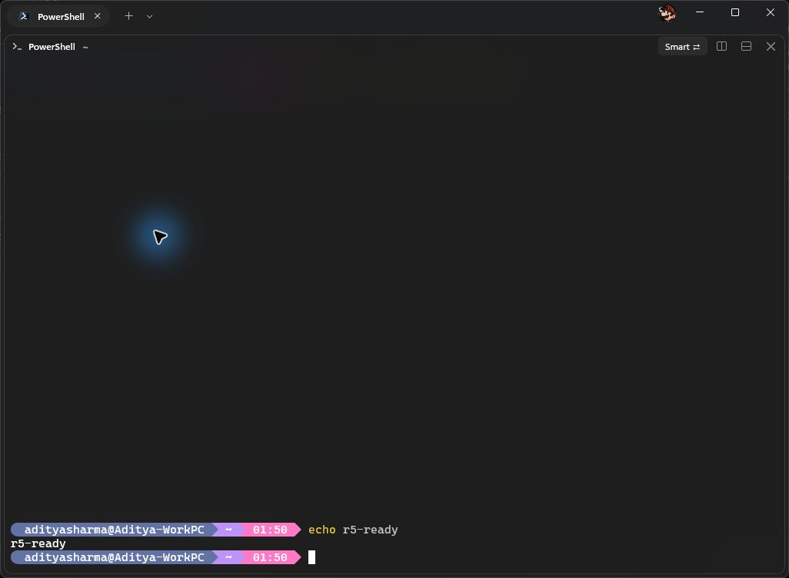
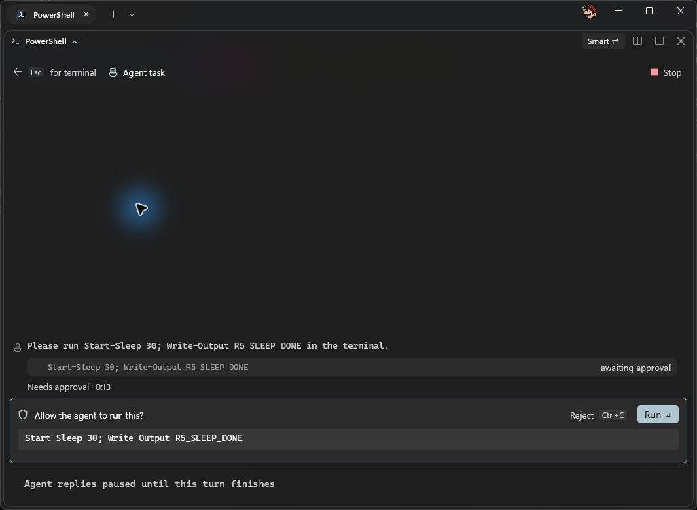
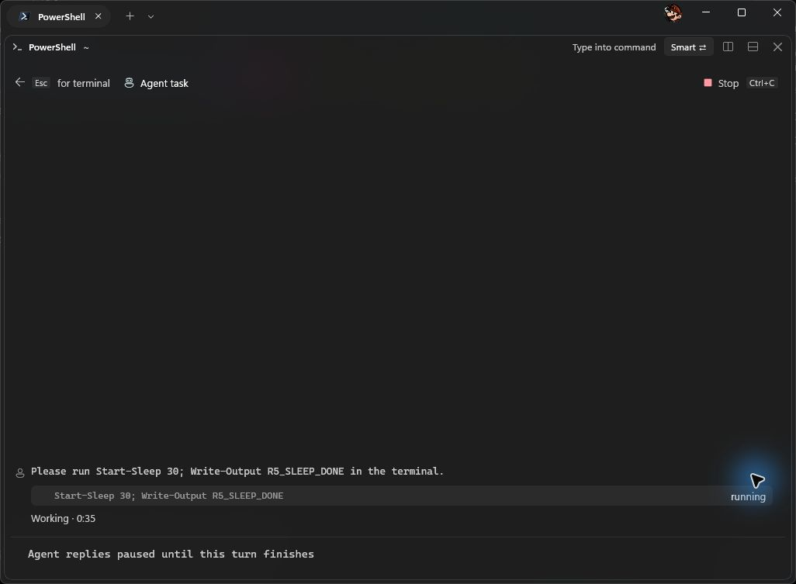
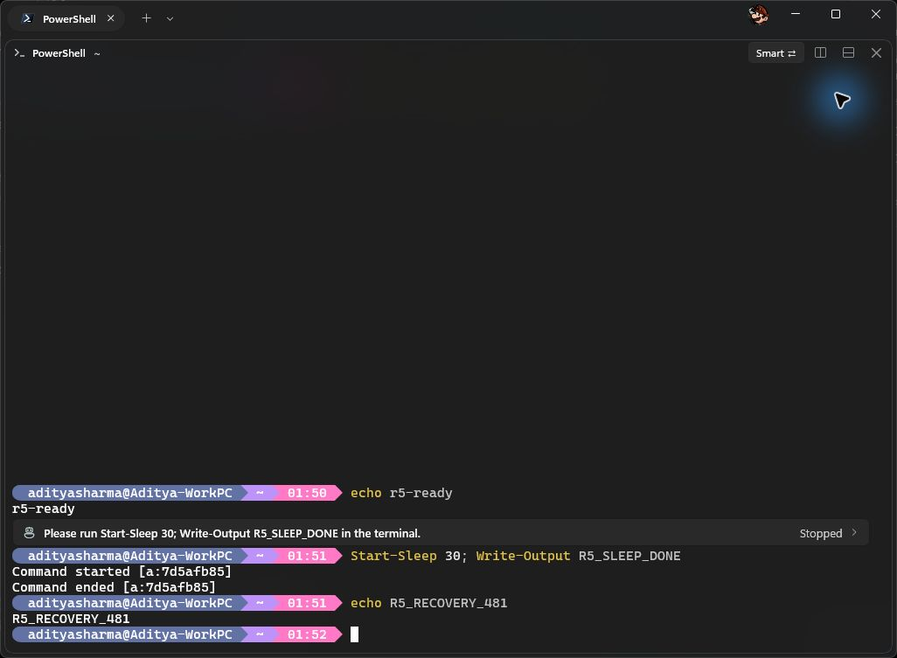

# Integrated prompt verification

Smart uses the native shell editor inside bottom-aligned terminal content. Legacy uses conventional top alignment. Both retain shell editing and `/agent` on the native input line. The conversation reply field is not a shell command editor. The prompt scrolls with history, unlike Warp's pinned editor.

## Current-build captures

These original screenshots came from one isolated process. The loaded App DLL target hash was `27300E8DBE7DC84633FAF52FB54ED7D25823B326ECCE303013D76F81E20573DF`. The Terminal DLL target hash was `63986789C310C1E2A91AFC1BB7D4F18AB8A3E0EA405F093D8D5F688FEDCEFF57`.

The recorded sequence selected request text before Run, used Escape during execution, attempted a harmless echo without input handoff, reopened the same task, stopped it and ran a recovery command. The excluded-input marker did not execute in displayed scrollback. This is not a comprehensive side-effect audit.

## Verification

- Seven isolated Release builds passed. Agents, Terminal including live-edge checks, Renderer, AgentUi timeline, Copilot normalization and real Copilot smoke passed. The real run included SDK tool binding and matching approval/execution call IDs.
- Focused native prompt and resize checks and full ConPTY passed. Coverage includes output boundaries, reordered OSC, Unicode, cancellation, input exclusion, recovery and draft restoration.
- Boat pre-commit passed on the final 207-file snapshot. Actionlint and Linux smoke passed earlier. These were equivalent Boat CLI runs, not a GitHub Actions workflow or Windows CI job. Linux Git fixtures were skipped with Git 2.43; the local Windows Git fixture passed.
- The focus fixture originally rejected retained Keyboard state after a Programmatic focus request, despite visible reply ownership and Escape delivery. Its corrected rerun exited 2 because it could not take foreground. It is inconclusive, not a pass. The historical Escape failure's cause remains unproven.
- Full AgentUi was not rerun because its Ctrl+End assertion had previously failed on an unchanged baseline. Native rebuild and Icons smoke were not repeated in the final pass.

## Final UX review

The five-round improvement limit was reached. Sol scored the observed subset 9.6/10, or 23/24 points. Opus scored it 7.9/10, or 19/24 points. Both excluded mode clarity and resizing/pane behavior. Neither approved overall acceptance. These are partial scores, not full-product ratings.

Current-build UI captures do not establish command/path completion, history/scrolling, Legacy or mode roundtrip, completed agent reply/follow-up, Read-Host handoff, errors, compact size or split panes. Passing underlying tests and earlier-build captures do not fill those visual coverage gaps.

Visible capture IDs and output-styled boundary lines remain. Ordered text fences retain protection against observed ConPTY OSC/text reordering. Later-line multiline and exactly-full-row resize cases, private PSReadLine field dependence, and a historical CoreMessaging crash remain unresolved. Complete accessibility, IME and light-theme verification is not claimed.
